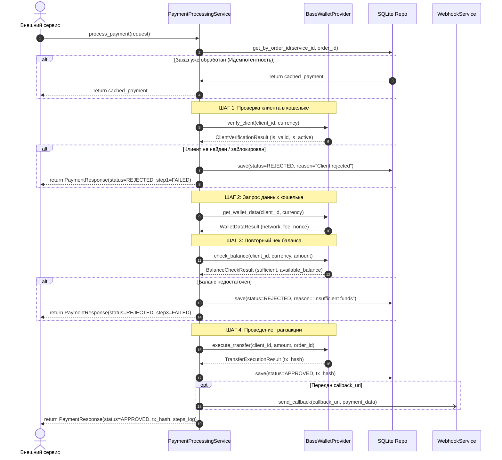
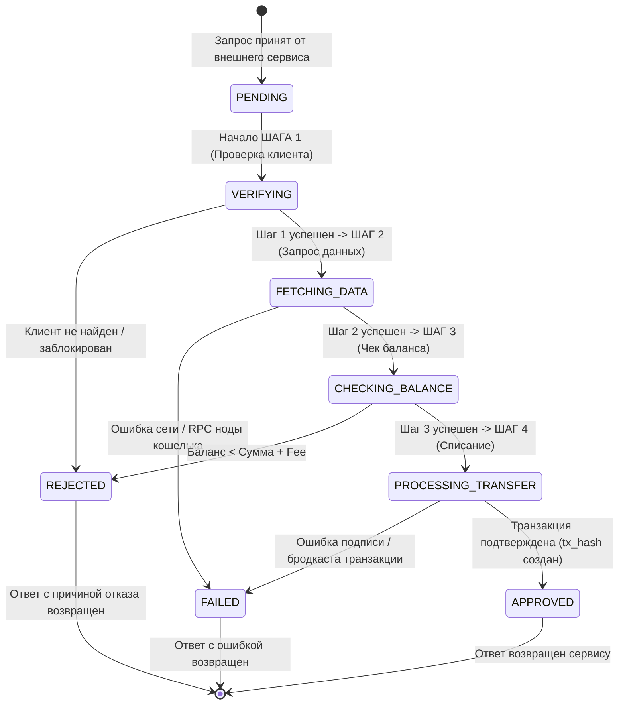
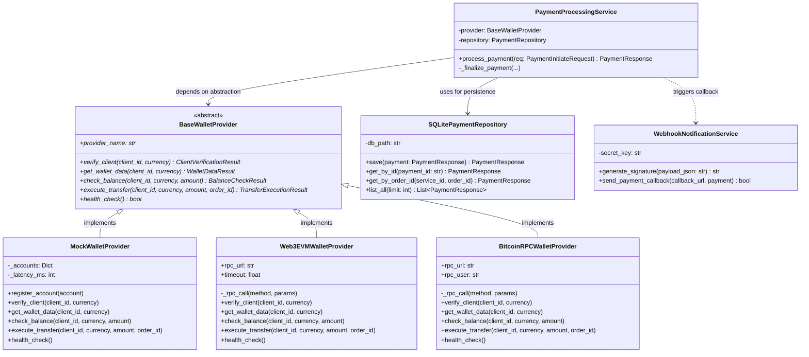

# Спецификация, Архитектура и Принципы Проектирования
## Сервис имитации и процессинга платежей (Payment Gateway Service)

---

## 1. Requirements (Требования к системе)

### 1.1. Функциональные требования (Functional Requirements - FR)
* **FR-1: Универсальный шлюз для внешних сервисов.** Сервис должен предоставлять стандартизированный REST API интерфейс (`POST /api/v1/payments/process`), принимающий запросы на оплату от любых внешних систем (E-commerce, Billing, Subscription services, Telegram-боты).
* **FR-2: Гарантия идемпотентности.** При повторном получении запроса с одинаковой связкой `(service_id, order_id)` сервис не должен выполнять повторное списание средств, а обязан возвращать сохраненный ранее результат транзакции.
* **FR-3: Обязательный 4-этапный бизнес-пайплайн:**
  1. **ШАГ 1 (Verify Client):** Проверка клиента в кошельке. Проверка существования учетной записи/адреса, активности статуса, прохождения комплаенс-проверок (отсутствие блокировок/санкций). При сбое — немедленное прерывание со статусом `REJECTED`.
  2. **ШАГ 2 (Get Wallet Data):** Запрос метаданных кошелька и блокчейн-сети. Получение типа адреса (EOA, Smart Contract, SegWit), идентификатора сети, расчет прогнозируемой комиссии (Gas/Miner Fee), nonce.
  3. **ШАГ 3 (Re-check Balance):** Повторный контрольный запрос на проверку баланса непосредственно перед транзакцией. Проверка условия: `Доступный баланс >= Сумма платежа + Комиссия`. При недостатке средств — отказ со статусом `REJECTED (INSUFFICIENT_FUNDS)`.
  4. **ШАГ 4 (Execute Payment):** Фиксация транзакции, списание/перевод средств, генерация блокчейн-хеша (`transaction_hash`) и возврат вызывающему сервису статуса `APPROVED`.
* **FR-4: Полный аудит шагов (Step-by-step Audit Trail).** В ответе вызывающему сервису и в базе данных должен фиксироваться подробный протокол всех пройденных этапов с таймстемпами и статусами (`SUCCESS` / `FAILED`).
* **FR-5: Автономные операции с кошельками.** Возможность для внешних сервисов вызывать предварительную проверку клиента (`POST /wallets/verify-client`), запрос метаданных (`GET /wallets/{id}/data`) и баланса (`GET /wallets/{id}/balance`) без создания заказа.
* **FR-6: Персистентное хранилище.** Все платежи, их статусы и протоколы шагов должны надежно сохраняться в реляционную базу данных (SQLite / `payments.db`).
* **FR-7: Асинхронные Webhooks.** При наличии поля `callback_url` в запросе сервис должен отправлять асинхронное HTTP POST уведомление о статусе с криптографической подписью HMAC SHA-256 (`X-Gateway-Signature`).
* **FR-8: Визуальный мониторинг.** Наличие встроенного Web-Dashboard (`/dashboard`) для визуализации процессов в реальном времени.

### 1.2. Нефункциональные требования (Non-Functional Requirements - NFR)
* **NFR-1: Расширяемость (Extensibility & Pluggability).** Архитектура должна позволять подключать любой Open Source криптокошелек или ноду (Bitcoin Core, Electrum, Geth/EVM, BTCPay Server, TON, Solana) без изменения бизнес-логики и контроллеров.
* **NFR-2: Производительность и асинхронность.** Реализация на базе неблокирующего асинхронного фреймворка (FastAPI + AsyncIO) для поддержания высокой пропускной способности при межсервисных сетевых вызовах.
* **NFR-3: Изоляция и отказоустойчивость (Fault Tolerance).** Сбои внешних RPC-узлов кошельков должны корректно перехватываться с возвратом понятного доменного кода ошибки (`WALLET_RPC_ERROR`), не приводя к падению сервера.
* **NFR-4: Безопасность (Security).** 
  - Валидация входных данных через строгие схемы Pydantic.
  - Поддержка аутентификации внешних микросервисов через заголовок `X-API-Key`.
  - Защита вебхуков от фальсификации через HMAC SHA-256 подпись.
* **NFR-5: Контейнеризация и переносимость.** Наличие `Dockerfile` и `docker-compose.yml` для мгновенного развертывания на любом сервере.

---

## 2. Архитектурные диаграммы (4 диаграммы)

### Диаграмма 1: Архитектура системы (Hexagonal / Ports & Adapters Architecture)

Показывает изоляцию доменной бизнес-логики от внешнего мира и адаптеров:

```mermaid
graph TD
    subgraph Driving_Adapters ["Входные адаптеры (Primary / Driving Adapters)"]
        ClientApp["Внешний сервис (E-commerce / Billing)"]
        AdminWeb["Веб-интерфейс (/dashboard)"]
        Swagger["OpenAPI / Swagger (/docs)"]
    end

    subgraph API_Layer ["Слой API (Controllers / Routing)"]
        PaymentsRouter["Payments API Controller"]
        WalletsRouter["Wallets API Controller"]
        HealthRouter["Health & System Controller"]
    end

    subgraph Application_Core ["Ядро приложения (Application Core / Domain)"]
        PaymentService["PaymentProcessingService\n(Оркестратор 4 шагов)"]
        DomainModels["Доменные модели и схемы\n(Payment, Steps, Balances)"]
    end

    subgraph Ports ["Порты (Interfaces / SPI)"]
        WalletPort["<< Interface >>\nBaseWalletProvider"]
        RepoPort["<< Interface >>\nPaymentRepository"]
    end

    subgraph Driven_Adapters ["Выходные адаптеры (Secondary / Driven Adapters)"]
        MockAdapter["MockWalletProvider\n(Симулятор кошелька)"]
        Web3Adapter["Web3EVMWalletProvider\n(Geth / Nethermind / Anvil)"]
        BTCAdapter["BitcoinRPCWalletProvider\n(bitcoind / Electrum / BTCPay)"]
        SQLiteRepo["SQLitePaymentRepository\n(payments.db)"]
        WebhookSender["WebhookNotificationService\n(HMAC SHA-256)"]
    end

    ClientApp -->|HTTP POST| PaymentsRouter
    AdminWeb -->|HTTP GET/POST| PaymentsRouter
    Swagger -->|HTTP| API_Layer

    PaymentsRouter --> PaymentService
    WalletsRouter --> WalletPort
    HealthRouter --> WalletPort

    PaymentService --> DomainModels
    PaymentService --> WalletPort
    PaymentService --> RepoPort
    PaymentService --> WebhookSender

    WalletPort <|.. MockAdapter
    WalletPort <|.. Web3Adapter
    WalletPort <|.. BTCAdapter

    RepoPort <|.. SQLiteRepo
```

---

### Диаграмма 2: Sequence Diagram (Детальный 4-этапный процессинг платежа)

Отображает взаимодействие участников и обработку альтернативных веток (отказы на шаге 1 и шаге 3):



---

### Диаграмма 3: State Machine Diagram (Жизненный цикл платежа)

Отражает переходы состояний заказа в процессе выполнения проверок:



---

### Диаграмма 4: Class Diagram (Диаграмма классов и интерфейсов ядра)

Демонстрирует объектно-ориентированную структуру и полиморфизм провайдеров:



---

## 3. Подход к архитектуре (Architectural Approach)

В основу архитектуры сервиса заложены следующие концепции:

### 3.1. Гексагональная архитектура (Hexagonal Architecture / Ports and Adapters)
* **Ядро (Domain Core):** Содержит бизнес-логику пайплайна оплаты (`PaymentProcessingService`), правила перехода состояний и сущности данных (`PaymentInitiateRequest`, `PaymentResponse`). Ядро является абсолютно независимым от сторонних библиотек блокчейна, базы данных или протокола передачи данных.
* **Входные порты и адаптеры (Driving/Primary):** Контроллеры FastAPI (`app/api/v1/endpoints/payments.py`), принимающие REST-запросы от внешних сервисов и транслирующие их в вызовы сервисного слоя.
* **Выходные порты и адаптеры (Driven/Secondary):** 
  - Порт криптокошелька: интерфейс `BaseWalletProvider`.
  - Порт репозитория: интерфейс `PaymentRepository`.
  - Реальные адаптеры подключаются снаружи (Mock, Web3 EVM RPC, Bitcoin RPC, SQLite).

### 3.2. Паттерн "Стратегия" (Strategy Pattern) и "Фабрика" (Factory Pattern)
* `BaseWalletProvider` выступает стратегией взаимодействия с блокчейн-узлом.
* `WalletProviderFactory` (`app/providers/factory.py`) инкапсулирует логику создания нужного адаптера в зависимости от настроек конфигурации (`WALLET_PROVIDER_TYPE=mock|web3_evm|bitcoin_rpc`) или динамических параметров.

### 3.3. Разделение ответственности (Separation of Concerns - SoC)
* Слой контроллеров отвечает исключительно за сериализацию, валидацию HTTP и возврат статусов.
* Сервисный слой отвечает исключительно за алгоритмический порядок выполнения 4 шагов.
* Слой провайдеров отвечает за сетевое и протокольное взаимодействие с блокчейн-нодами.
* Слой хранилища отвечает за CRUD-операции и сохранение состояния на диск.

---

## 4. Реализация принципов SOLID в проекте

### S — Single Responsibility Principle (Принцип единственной ответственности)
Каждый модуль и класс в системе имеет ровно одну причину для изменения:
1. **`PaymentProcessingService`** ([`app/services/payment_service.py`](file:///c:/Users/user/Documents/GitHub/Adv_soft_mid/app/services/payment_service.py)):  
   Отвечает **только** за сценарий и порядок прохождения 4 шагов платежа. Он не знает, как устроен SQL-запрос или как сформировать JSON-RPC к ноде Ethereum.
2. **`MockWalletProvider` / `Web3EVMWalletProvider`** ([`app/providers/`](file:///c:/Users/user/Documents/GitHub/Adv_soft_mid/app/providers/)):  
   Отвечают **только** за протокол взаимодействия с криптокошельком/нодой.
3. **`SQLitePaymentRepository`** ([`app/services/storage.py`](file:///c:/Users/user/Documents/GitHub/Adv_soft_mid/app/services/storage.py)):  
   Отвечает **только** за персистентность данных в SQLite (SQL-схема, сериализация/десериализация JSON шагов).
4. **`WebhookNotificationService`** ([`app/services/webhook_service.py`](file:///c:/Users/user/Documents/GitHub/Adv_soft_mid/app/services/webhook_service.py)):  
   Отвечает **только** за подписание полезной нагрузки через HMAC SHA-256 и HTTP-доставку вебхука.
5. **`app/models/schemas.py`** ([`app/models/schemas.py`](file:///c:/Users/user/Documents/GitHub/Adv_soft_mid/app/models/schemas.py)):  
   Отвечает **только** за типизацию и валидацию данных запросов и ответов.

### O — Open/Closed Principle (Принцип открытости / закрытости)
Программные сущности открыты для расширения, но закрыты для модификации:
* Сервис спроектирован так, чтобы в будущем можно было подключить **любой Open Source криптокошелек** (например, Monero, TON, Solana, Gnosis Safe).
* Для добавления нового кошелька разработчик **не меняет ни единой строки** в классе `PaymentProcessingService` или контроллерах `payments.py`.
* Достаточно создать новый класс, например `class TonWalletProvider(BaseWalletProvider)`, реализовать 4 стандартных метода и зарегистрировать его в `WalletProviderFactory`. Ядро сервиса автоматически продолжит работу с новым кошельком.

### L — Liskov Substitution Principle (Принцип подстановки Лисков)
Объекты подклассов могут безболезненно заменять объекты суперкласса без нарушения работы программы:
* Все адаптеры кошельков (`MockWalletProvider`, `Web3EVMWalletProvider`, `BitcoinRPCWalletProvider`) являются строгими подтипами `BaseWalletProvider`.
* Они возвращают единообразные типизированные структуры: `ClientVerificationResult`, `WalletDataResult`, `BalanceCheckResult`, `TransferExecutionResult`.
* В `PaymentProcessingService` можно прозрачно подставить как `MockWalletProvider`, так и `Web3EVMWalletProvider` — поведение оркестратора не нарушится (что доказано юнит-тестами).

### I — Interface Segregation Principle (Принцип разделения интерфейсов)
Клиенты не должны зависеть от методов, которые они не используют:
* Интерфейс `BaseWalletProvider` содержит минимальный, атомарный набор методов, строго соответствующий стадиям жизненного цикла криптоплатежа: `verify_client`, `get_wallet_data`, `check_balance`, `execute_transfer`. В нем нет посторонних методов (например, управления стейкингом, минтинга NFT или смены паролей кошелька).
* Внешний REST API разделен на узкоспециализированные контроллеры:
  - `/payments` — проведение оплат и история;
  - `/wallets` — проверки клиентов и балансов;
  - `/health` — мониторинг доступности;
  - `/dashboard` — пользовательский интерфейс.

### D — Dependency Inversion Principle (Принцип инверсии зависимостей)
Модули верхних уровней не зависят от модулей нижних уровней; оба уровня зависят от абстракций:
* Класс `PaymentProcessingService` (верхний уровень) не импортирует и не инстанциирует напрямую `MockWalletProvider` или `Web3EVMWalletProvider` (нижний уровень). Он зависит исключительно от абстракции `BaseWalletProvider`.
* Внедрение зависимостей (Dependency Injection) организовано через конструктор:
  ```python
  class PaymentProcessingService:
      def __init__(self, provider: BaseWalletProvider, repository: PaymentRepository = None):
          self.provider = provider
          self.repository = repository
  ```
* В слое API FastAPI внедрение абстракций осуществляется через механизм `Depends(get_wallet_provider)` в [`app/api/deps.py`](file:///c:/Users/user/Documents/GitHub/Adv_soft_mid/app/api/deps.py). Это позволило легко подменять провайдеры в тестах (`tests/test_payments_flow.py`) без изменения рабочего кода.

