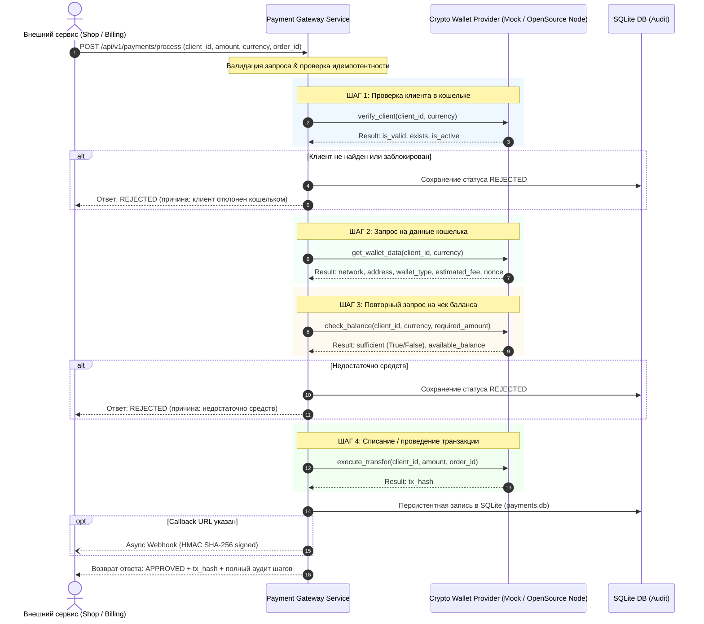

# Crypto Payment Gateway Service (Платежный микросервис-шлюз)

Бэкенд-сервис имитации и обработки платежей, к которому обращаются любые внешние сервисы (интернет-магазины, биллинг-платформы, микросервисы заказов).

---

## 🎯 Цель сервиса и реализуемый бизнес-пайплайн

Сервис принимает запрос на оплату от любого стороннего сервиса и строго выполняет **4 обязательных этапа**:



---

## 🔌 Интеграция с любым Open-Source криптокошельком

Проект спроектирован по архитектуре **Hexagonal Architecture (Ports & Adapters)**.  
Бизнес-логика оркестрации платежей полностью отделена от блокчейн-протоколов через единый абстрактный контракт [`BaseWalletProvider`](app/providers/base.py).

### Готовые адаптеры в проекте:
1. **`MockWalletProvider`** ([`app/providers/mock_provider.py`](app/providers/mock_provider.py)):
   - Полноценный симулятор кошелька с настраиваемыми счетами, балансами, задержками сети (`MOCK_NETWORK_LATENCY_MS`) и генерацией хешей транзакций.
2. **`Web3EVMWalletProvider`** ([`app/providers/web3_provider.py`](app/providers/web3_provider.py)):
   - Адаптер для любых открытых EVM-нод: **Geth (Go-Ethereum)**, **Nethermind**, **Besu**, **Anvil/Hardhat**, **Polygon**, **Arbitrum** через JSON-RPC 2.0 (`eth_getCode`, `eth_chainId`, `eth_getBalance`, `eth_gasPrice`).
3. **`BitcoinRPCWalletProvider`** ([`app/providers/btc_provider.py`](app/providers/btc_provider.py)):
   - Адаптер для **Bitcoin Core (bitcoind)**, **Electrum Server** или **BTCPay Server** через Bitcoin JSON-RPC (`validateaddress`, `getreceivedbyaddress`, `estimatesmartfee`).

### Как подключить любой другой open-source кошелек:
Достаточно унаследоваться от `BaseWalletProvider` и реализовать 4 метода:
```python
from app.providers.base import BaseWalletProvider

class MyCustomCryptoWalletProvider(BaseWalletProvider):
    @property
    def provider_name(self) -> str:
        return "MyOpenSourceWallet"

    async def verify_client(self, client_id_or_address: str, currency: str):
        # 1. Проверка адреса/пользователя в ноде кошелька
        ...

    async def get_wallet_data(self, client_id_or_address: str, currency: str):
        # 2. Запрос комиссии и метаданных
        ...

    async def check_balance(self, client_id_or_address: str, currency: str, required_amount: Decimal):
        # 3. Повторная проверка актуального баланса
        ...

    async def execute_transfer(self, client_id_or_address: str, currency: str, amount: Decimal, order_id: str):
        # 4. Проведение транзакции
        ...
```
И зарегистрировать его в [`WalletProviderFactory`](app/providers/factory.py).

---

## 🚀 Быстрый старт на сервере

### Вариант 1: Локальный запуск (Python 3.10+)

```bash
# 1. Установка зависимостей
pip install -r requirements.txt

# 2. Запуск сервера
python -m uvicorn app.main:app --host 0.0.0.0 --port 8000 --reload
```

### Вариант 2: Запуск в Docker / Docker Compose

```bash
docker compose up -d --build
```

Сервер будет доступен по адресу `http://localhost:8000`:
- **Интерактивный Dashboard & Monitoring**: [http://localhost:8000/dashboard](http://localhost:8000/dashboard)
- **Интерактивная документация Swagger UI**: [http://localhost:8000/docs](http://localhost:8000/docs)
- **Альтернативная спецификация ReDoc**: [http://localhost:8000/redoc](http://localhost:8000/redoc)
- **Health check**: [http://localhost:8000/api/v1/health](http://localhost:8000/api/v1/health)

---

## 📡 Примеры использования API

### 1. Обработка платежа от внешнего сервиса

**Запрос (`POST /api/v1/payments/process`):**
```bash
curl -X POST "http://localhost:8000/api/v1/payments/process" \
     -H "Content-Type: application/json" \
     -d '{
       "service_id": "ecommerce_orders_service",
       "order_id": "ORD-2026-9041",
       "client_id": "client_rich_01",
       "amount": 250.00,
       "currency": "USDT",
       "description": "Оплата заказа в интернет-магазине"
     }'
```

**Успешный ответ (`200 OK`):**
```json
{
  "payment_id": "pay_9a2b8e1f0c4d",
  "order_id": "ORD-2026-9041",
  "service_id": "ecommerce_orders_service",
  "client_id": "client_rich_01",
  "amount": "250.00",
  "currency": "USDT",
  "status": "APPROVED",
  "is_success": true,
  "transaction_hash": "0x4b78a99478f79d1a3c7467fa3b3e028b1e42...",
  "fee_estimated": "0.50",
  "failure_reason": null,
  "steps": [
    {
      "step": "VERIFY_CLIENT",
      "status": "SUCCESS",
      "message": "Клиент найден и активен в кошельке.",
      "timestamp": "2026-11-08T19:00:00Z"
    },
    {
      "step": "GET_WALLET_DATA",
      "status": "SUCCESS",
      "message": "Данные получены: сеть Ethereum/Polygon",
      "data": {"estimated_fee": "0.50", "wallet_type": "OPEN_SOURCE_HD_WALLET"}
    },
    {
      "step": "CHECK_BALANCE",
      "status": "SUCCESS",
      "message": "Баланс подтвержден: доступно 50000.00 USDT",
      "data": {"available_balance": "50000.00", "required_amount": "250.00"}
    },
    {
      "step": "EXECUTE_PAYMENT",
      "status": "SUCCESS",
      "message": "Транзакция успешно подтверждена. Hash: 0x4b78...",
      "data": {"tx_hash": "0x4b78a994..."}
    }
  ],
  "created_at": "2026-11-08T19:00:00Z",
  "completed_at": "2026-11-08T19:00:00.050Z"
}
```

### 2. Тестовые счета в Mock-кошельке для проверки сценариев:

| Client ID | Начальный баланс | Сценарий проверки |
|---|---|---|
| `client_rich_01` | 50,000 USDT, 2.1 BTC | Все 4 шага успешны (`APPROVED`) |
| `client_poor_02` | 15 USDT | Ошибка на Шаге 3 — повторный чек баланса (`REJECTED`, недостаток средств) |
| `client_blocked_03` | 100,000 USDT (Blocked) | Ошибка на Шаге 1 — проверка клиента (`REJECTED`, блокировка) |
| `ghost_user_999` | Не зарегистрирован | Ошибка на Шаге 1 — проверка клиента (`REJECTED`, клиент не найден) |

---

## 🧪 Запуск автоматических тестов

```bash
pytest -v
```

---

## 🤖 Запуск скрипта-симулятора обращений стороннего сервиса

В проекте есть скрипт [`scripts/simulate_external_client.py`](scripts/simulate_external_client.py), который отправляет реальные HTTP-запросы разных сценариев:
```bash
python scripts/simulate_external_client.py
```

---

## 📦 Импорт в Postman

В корне репозитория находится файл [`postman_collection.json`](postman_collection.json), содержащий полный набор готовых запросов для всех сценариев и проверок.

---

## 📚 Архитектурная документация и спецификация

Подробный документ с описанием функциональных и нефункциональных требований, 4 архитектурных диаграмм (Mermaid), описанием подхода Hexagonal Architecture и детальным разбором принципов SOLID доступен в файле:
👉 **[`ARCHITECTURE_AND_SPECIFICATION.md`](ARCHITECTURE_AND_SPECIFICATION.md)**


## 📦 Импорт в Postman

В корне репозитория находится файл [`postman_collection.json`](postman_collection.json), содержащий полный набор готовых запросов для всех сценариев и проверок.

---

## 📚 Архитектурная документация и спецификация

Подробный документ с описанием функциональных и нефункциональных требований, 4 архитектурных диаграмм (Mermaid), описанием подхода Hexagonal Architecture и детальным разбором принципов SOLID доступен в файле:
👉 **[`ARCHITECTURE_AND_SPECIFICATION.md`](ARCHITECTURE_AND_SPECIFICATION.md)**

