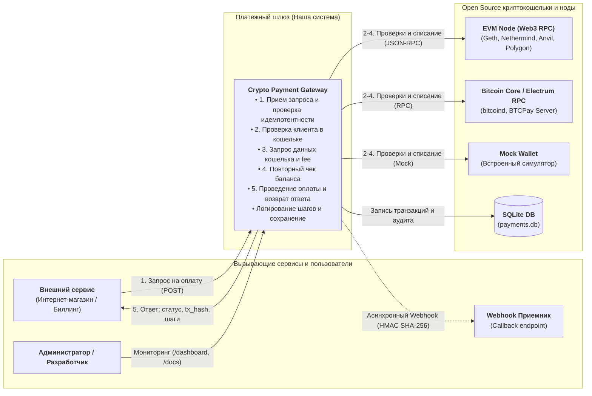
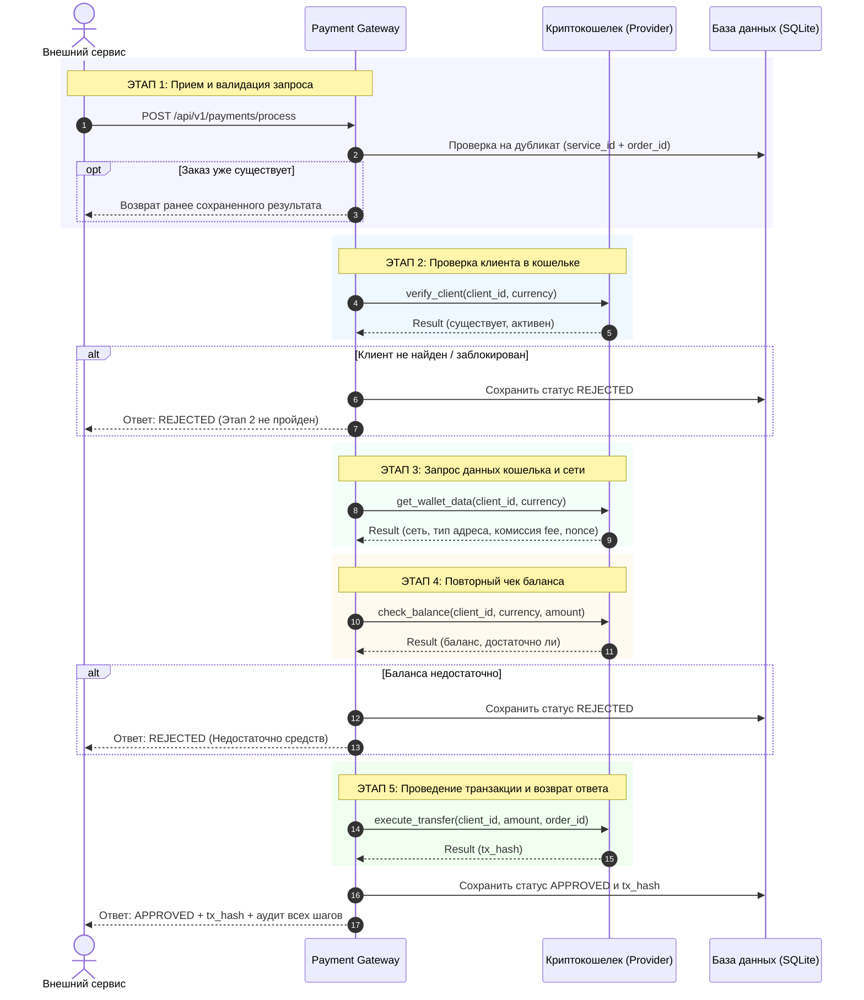
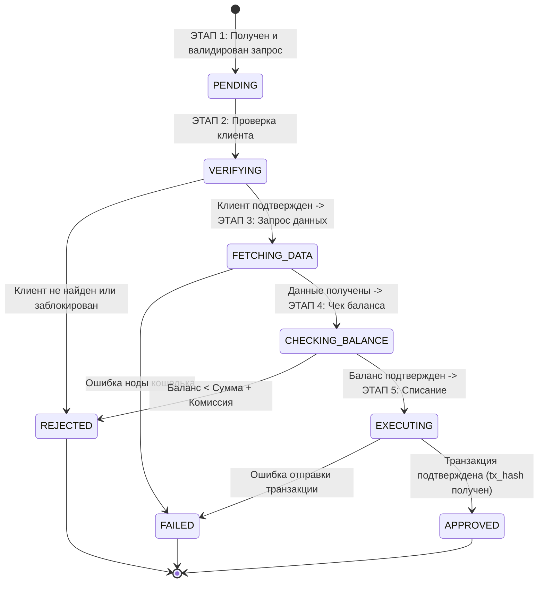
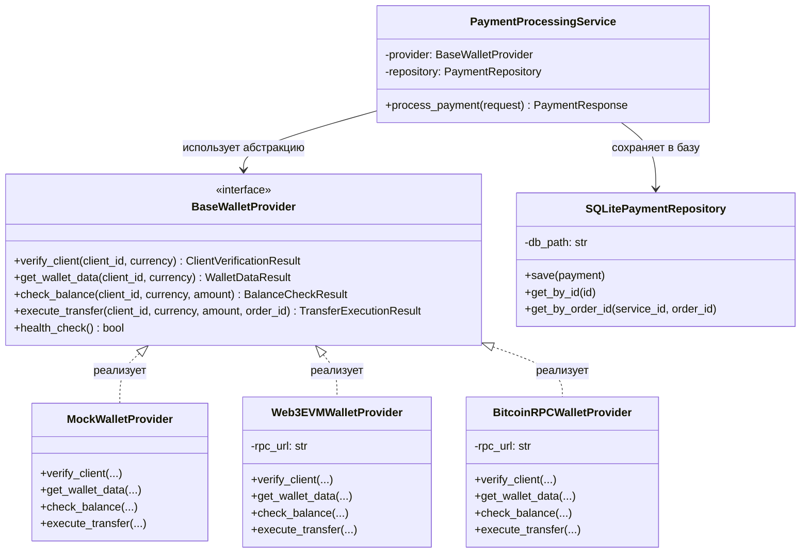

# Архитектура и спецификация сервиса оплаты

---

## 1. Требования

### Требования к исполнению 5-этапного пайплайна

1. **Этап 1: Прием и валидация запроса от внешнего сервера.**
   * Прием входящего запроса по HTTP (POST JSON).
   * Обязательные параметры:
     * `service_id` — уникальный идентификатор вызывающего сервиса;
     * `order_id` — уникальный номер заказа во внешней системе;
     * `client_id` — идентификатор клиента или публичный крипто-адрес;
     * `amount` — сумма платежа (строго больше нуля);
     * `currency` — тикер криптовалюты/токена (`USDT`, `BTC`, `ETH`).
   * Контроль идемпотентности: при повторном запросе с совпадающей связкой `(service_id, order_id)` сервис не должен выполнять повторные списания, а обязан сразу вернуть ранее сохраненный результат.

2. **Этап 2: Проверка клиента в кошельке.**
   * От кошелька требуется подтверждение: аккаунт/адрес зарегистрирован, активен и не заблокирован (комплаенс/санкции).
   * При сбое проверки процесс немедленно останавливается со статусом `REJECTED`, последующие этапы не выполняются.

3. **Этап 3: Запрос данных кошелька и сети.**
   * От кошелька требуется предоставить: идентификатор сети, тип кошелька/адреса, оценку сетевой комиссии (gas fee / miner fee) и текущий nonce.

4. **Этап 4: Повторный чек баланса.**
   * Баланс клиента запрашивается **повторно** непосредственно перед транзакцией (для исключения race condition и двойной траты).
   * Условие выполнения: `доступный баланс >= сумма платежа + расчетная комиссия`. При нехватке средств — отказ со статусом `REJECTED`.

5. **Этап 5: Проведение транзакции и возврат ответа.**
   * Требуется списать баланс / отправить подписанную транзакцию в сеть и получить уникальный идентификатор (`transaction_hash`).
   * В итоговом ответе вызывающему сервису возвращается статус (`APPROVED` или `REJECTED`), hash и протокол каждого из пройденных этапов с таймстемпами.

### Требования для интеграции криптокошельков
* Изоляция бизнес-логики: процессинг платежей не должен зависеть от специфики конкретного блокчейна.
* Унифицированный интерфейс: подключение любого Open Source кошелька (EVM/Geth, Bitcoin Core, Electrum, BTCPay Server, Mock) реализуется через единый абстрактный контракт (`BaseWalletProvider`).
* Расширяемость: добавление нового кошелька должно производиться без изменения кода ядра сервиса.
* Асинхронность: все сетевые вызовы к узлам и нодам кошельков должны быть неблокирующими (AsyncIO).

---

## 2. Диаграммы системы

### Диаграмма 1: Контекстная диаграмма (Context Diagram)
Определяет границы платежного шлюза, внешние вызывающие сервисы и подключаемые блокчейн-ноды:



---

### Диаграмма 2: Диаграмма последовательности (Sequence Diagram)
Показывает хронологию 5 этапов и поведение при ошибках на этапах проверки клиента и баланса:



---

### Диаграмма 3: Диаграмма состояний (State Machine Diagram)
Отображает переходы статусов платежа по этапам:



---

### Диаграмма 4: Диаграмма классов (Class Diagram)
Показывает структуру классов и полиморфизм адаптеров кошельков:



---

## 3. Подход к архитектуре

В проекте используется **Гексагональная архитектура (Ports and Adapters)**:

1. **Доменное ядро (`PaymentProcessingService`):**
   * Содержит только бизнес-логику последовательного выполнения этапов и правила смены статусов.
   * Ядро ничего не знает о протоколах HTTP, структуре таблиц SQL и деталях блокчейнов.
2. **Порты (Интерфейсы):**
   * `BaseWalletProvider` — порт взаимодействия с кошельками.
   * `PaymentRepository` — порт сохранения данных.
3. **Адаптеры:**
   * Входные адаптеры: контроллеры FastAPI (`payments.py`, `wallets.py`), переводящие входящие HTTP-запросы в вызовы ядра.
   * Выходные адаптеры:
     * `MockWalletProvider` — симулятор кошелька для тестов;
     * `Web3EVMWalletProvider` — адаптер для EVM-нод (Geth/Nethermind) по JSON-RPC;
     * `BitcoinRPCWalletProvider` — адаптер для Bitcoin Core / Electrum;
     * `SQLitePaymentRepository` — адаптер персистентного хранения в файле SQLite.

**Преимущество:** подключение любого нового Open Source кошелька (TON, Solana, Monero) сводится к написанию одного адаптера без изменения существующей бизнес-логики.

---

## 4. Где и как применен SOLID

### S — Single Responsibility (Единственная ответственность)
Каждый модуль решает строго одну задачу:
* `PaymentProcessingService` ([`app/services/payment_service.py`](app/services/payment_service.py)) — отвечает только за пошаговую координацию этапов платежа.
* `BaseWalletProvider` и адаптеры ([`app/providers/`](app/providers/)) — отвечают только за сетевое общение с кошельками и блокчейн-узлами.
* `SQLitePaymentRepository` ([`app/services/storage.py`](app/services/storage.py)) — отвечает только за операции сохранения и чтения из базы SQLite.
* `WebhookNotificationService` ([`app/services/webhook_service.py`](app/services/webhook_service.py)) — отвечает только за расчет HMAC-подписи и отправку вебхуков.
* `schemas.py` ([`app/models/schemas.py`](app/models/schemas.py)) — отвечает только за валидацию структур данных.

### O — Open/Closed (Открытость к расширению, закрытость к изменению)
* Чтобы добавить поддержку нового Open Source криптокошелька, **не нужно менять ни одной строчки** в `PaymentProcessingService` или в API-контроллерах.
* Достаточно создать новый класс адаптера (например, `TonWalletProvider`), унаследованный от `BaseWalletProvider`, и зарегистрировать его в фабрике `WalletProviderFactory`. Ядро готово к работе с новым кошельком без изменений.

### L — Liskov Substitution (Подстановка Лисков)
* Любой адаптер кошелька (`MockWalletProvider`, `Web3EVMWalletProvider`, `BitcoinRPCWalletProvider`) может быть передан в `PaymentProcessingService` вместо базового интерфейса.
* Все они соблюдают один и тот же контракт входных и выходных типов (`ClientVerificationResult`, `WalletDataResult`, `BalanceCheckResult`, `TransferExecutionResult`), не ломая логику оркестратора.

### I — Interface Segregation (Разделение интерфейсов)
* Интерфейс `BaseWalletProvider` содержит минимально необходимый набор из 4 методов (`verify_client`, `get_wallet_data`, `check_balance`, `execute_transfer`), строго соответствующий операциям с кошельком. В нем нет лишних методов (стейкинг, экспорт приватных ключей, минтинг).
* Эндпоинты API разделены на отдельные независимые модули: `/payments`, `/wallets`, `/health`, `/dashboard`.

### D — Dependency Inversion (Инверсия зависимостей)
* Высокоуровневый модуль `PaymentProcessingService` не создает и не импортирует конкретные классы `MockWalletProvider` или `Web3EVMWalletProvider`.
* Он зависит только от абстракции `BaseWalletProvider`, которая передается ему извне через конструктор (Dependency Injection):
  ```python
  class PaymentProcessingService:
      def __init__(self, provider: BaseWalletProvider, repository: PaymentRepository = None):
          self.provider = provider
          self.repository = repository
  ```
* В FastAPI связывание выполняется через механизм внедрения зависимостей `Depends(get_wallet_provider)` в [`app/api/deps.py`](app/api/deps.py), что позволяет легко подменять провайдеры в тестах.
